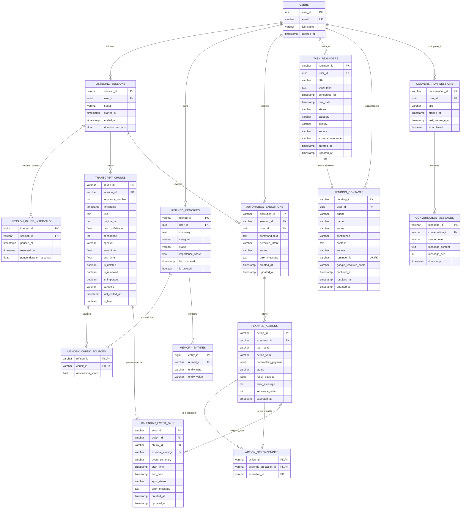

# EchoVault: Relational Database Normalization Analysis
**Course:** Database Management Systems (AP Checkpoint 1 — CP1)  
**Academic Year:** 2026  
**Level:** Second-Year B.Tech Computer Science & Engineering  
**System Under Study:** EchoVault — Autonomous Personal Intelligence Platform  
**Document Identifier:** `ECHOVAULT-DBMS-CP1-NORM-2026`  
**Location:** `dbms/01_normalization.md`  

---

## 1. Title and Project Information

- **Project Name:** EchoVault
- **Tagline:** Remember. Understand. Act. — Local-First Personal Intelligence Layer
- **Subject:** Database Management Systems (CS2001 / Academic Practicum CP1)
- **Author/Student:** Yash Gupta
- **Target Database Management System:** PostgreSQL 16+ (Proposed Production Schema) / SQLite 3 (Existing Local Prototype)
- **Repository Under Inspection (Source of Truth):** `/Users/yashgupta/Desktop/EchoVault`
- **Output Artifact Location:** `EchoVault_AP_2026/dbms/01_normalization.md`
- **Date of Verification & Analysis:** November 2026

---

## 2. Executive Summary & Introduction to EchoVault

### 2.1 System Purpose & Core Value Proposition
EchoVault is an autonomous, privacy-preserving, local-first personal intelligence platform. Unlike conventional conversational chatbots that operate in isolated, ephemeral context windows, EchoVault is designed to continuously ingest, organize, and retain ambient speech, extract structured knowledge, preserve historical context, and autonomously execute multi-step workflows across external services (e.g., Google Calendar, Google Contacts, local task systems).

The system operates across three fundamental pillars:
1. **Remember:** Ingest real-time spoken audio, segment speech using local Voice Activity Detection (WebRTC VAD), transcribe speech on-device via quantized Whisper models (`faster-whisper`), and persist verbatim transcript chunks alongside LLM-consolidated structured memories.
2. **Understand:** Disambiguate multi-turn conversational references, resolve relative temporal expressions (*"next Tuesday at 3 PM"*), extract named entities (people, organizations, commitments, deadlines), and route intent through a multi-stage classification pipeline.
3. **Act:** Plan, validate, schedule, and execute multi-command directed acyclic graphs (DAGs) across integrated tools, with strict human-in-the-loop safeguards for destructive operations.

```
  ┌────────────────────────────────────────────────────────────────────────┐
  │                           ECHOVAULT RUNTIME                            │
  ├───────────────────┬────────────────────────────┬───────────────────────┤
  │     REMEMBER      │         UNDERSTAND         │          ACT          │
  │ Continuous audio  │ Contextual, semantic, and  │ Multi-action,         │
  │ capture & memory  │ temporal disambiguation    │ autonomous tool exec  │
  └───────────────────┴────────────────────────────┴───────────────────────┘
```

### 2.2 Objective of this Checkpoint
The primary objective of Checkpoint 1 (CP1) is to perform a rigorous, academic-grade database normalization analysis on EchoVault's persistence architecture. By conducting an evidence-based audit of the actual EchoVault source repository, this document identifies existing schema design flaws—including non-atomic JSON structures, missing relational integrity constraints, transitive dependencies, and potential anomaly vectors—and systematically transforms the data model from Unnormalized Form (UNF) through First (1NF), Second (2NF), Third (3NF), and Boyce-Codd Normal Form (BCNF).

---

## 3. Scope of Database Normalization

### 3.1 Establishing the Design Boundary: What Belongs in the Relational DBMS
A critical competency in modern database engineering is distinguishing relational state from vector embeddings, flat media files, transient caches, and external third-party systems. In EchoVault, data is segregated into distinct architectural layers:

```
┌──────────────────────────────────────────────────────────────────────────────┐
│                        ECHOVAULT STORAGE ARCHITECTURE                        │
├──────────────────────┬────────────────────────┬──────────────────────────────┤
│ Relational (ACID)    │ Vector Space (FAISS)   │ Filesystem & External APIs   │
├──────────────────────┼────────────────────────┼──────────────────────────────┤
│ • Listening Sessions │ • Raw 384-d L2 Vectors │ • Audio Chunks (.wav cache)  │
│ • Pause Intervals    │   (all-MiniLM-L6-v2)   │ • OAuth Tokens (JSON disk)   │
│ • Transcript Chunks  │ • Refined 384-d L2     │ • Application Logs           │
│ • Refined Memories   │   Semantic Vectors     │ • Google Calendar API (v3)   │
│ • Planned Actions    │                        │ • Google People API (v1)     │
│ • Task Reminders     │                        │ • DuckDuckGo Search API      │
│ • Pending Contacts   │                        │                              │
│ • Calendar Sync      │                        │                              │
│ • Conversation Turns │                        │                              │
└──────────────────────┴────────────────────────┴──────────────────────────────┘
```

1. **Relational Database Scope (The Focus of Normalization):**
   - Ingestion sessions, state transitions, pause/resume intervals, and transcript text metadata.
   - Refined long-term memories, importance scoring, and extracted entities.
   - Agent action planning, dependency graphs, tool execution states, and execution histories.
   - User tasks, deadlines, scheduled reminders, and follow-up alerts.
   - Ambiguous contact buffers (pending contacts captured without a verified name).
   - Calendar event synchronization tracking and external reference mappings.
   - Conversational message logs, user interactions, and audit trails.

2. **Non-Relational Scope (Explicitly Excluded from Relational Normalization):**
   - **Dense Embedding Vectors:** 384-dimensional floating-point vectors generated by `sentence-transformers/all-MiniLM-L6-v2` are stored in dedicated FAISS indices (`data/faiss.index` and `data/faiss_refined.index`). Attempting to store high-dimensional continuous arrays in relational tables degrades index traversal performance and violates relational modeling principles.
   - **Binary Audio Chunks:** Audio recorded at 16 kHz 16-bit mono PCM is saved as transient `.wav` files on the filesystem under `data/audio_chunks/`. Only the file metadata and duration are referenced in database logs.
   - **OAuth 2.0 Credentials:** Ephemeral access tokens, refresh tokens, and client secrets are maintained on disk (`data/google_oauth_tokens.json`) or in the OS keychain via Electron's `safeStorage`.
   - **External Third-Party Repositories:** Remote Google Calendar event representations and Google People API contact cards reside in Google's cloud infrastructure. EchoVault stores only local foreign references (`external_event_id`, `google_resource_name`) for synchronization.

---

## 4. Repository and Storage Architecture Analysis (Codebase Evidence)

### 4.1 Codebase Audit & Source of Truth Verification
A thorough inspection of `/Users/yashgupta/Desktop/EchoVault` was conducted to establish empirical evidence before designing any relational schema.

The backend application is implemented in Python using FastAPI, SQLAlchemy 2.0, and SQLite 3. The primary database configuration is defined in `backend/config.py`, pointing to `data/echovault.db`.

```python
# From /Users/yashgupta/Desktop/EchoVault/backend/config.py
DEFAULT_DATA_DIR = os.path.join(os.path.dirname(os.path.dirname(__file__)), "data")
BASE_DATA_DIR = os.environ.get("ECHOVAULT_DATA_DIR", DEFAULT_DATA_DIR)
DB_PATH = os.path.join(BASE_DATA_DIR, "echovault.db")

def get_db_url():
    return f"sqlite:///{DB_PATH}"
```

### 4.2 Verified Existing Prototype Relational Schema (SQLite 3 / SQLAlchemy)
Direct source inspection of `backend/database.py` and inspection of the live SQLite database (`sqlite3 data/echovault.db ".schema"`) verified the existence of **seven primary relational tables** currently implemented in the development prototype:

```
Existing Tables Implemented in echovault.db:
 1. transcript_chunks
 2. refined_memories
 3. calendar_automations
 4. listening_sessions
 5. automation_executions
 6. task_reminders
 7. pending_contacts
```

The exact existing schema definitions from `backend/database.py` are audited below:

1. **`TranscriptChunk` (`transcript_chunks`):**
   - Attributes: `id` (INTEGER, PK), `chunk_id` (VARCHAR, Unique), `session_id` (VARCHAR), `timestamp` (DATETIME), `text` (TEXT), `original_text` (TEXT), `confidence` (FLOAT), `raw_confidence` (FLOAT), `is_deleted` (BOOLEAN), `is_reviewed` (BOOLEAN), `is_important` (BOOLEAN), `category` (VARCHAR), `last_edited_at` (DATETIME), `speaker` (VARCHAR), `start_time` (FLOAT), `end_time` (FLOAT), `sequence_number` (INTEGER), `is_final` (BOOLEAN).
2. **`RefinedMemory` (`refined_memories`):**
   - Attributes: `id` (INTEGER, PK), `refined_id` (VARCHAR, Unique), `source_memory_ids` (JSON), `summary` (TEXT), `category` (VARCHAR), `status` (VARCHAR), `importance_score` (FLOAT), `last_updated` (DATETIME), `entities` (JSON), `metadata_json` (JSON), `is_deleted` (BOOLEAN).
3. **`CalendarAutomation` (`calendar_automations`):**
   - Attributes: `id` (INTEGER, PK), `chunk_id` (VARCHAR, Unique), `summary` (VARCHAR), `start_time` (DATETIME), `end_time` (DATETIME), `external_event_id` (VARCHAR), `status` (VARCHAR), `error_message` (TEXT), `created_at` (DATETIME).
4. **`ListeningSession` (`listening_sessions`):**
   - Attributes: `id` (INTEGER, PK), `session_id` (VARCHAR, Unique), `status` (VARCHAR), `started_at` (DATETIME), `paused_at` (DATETIME), `ended_at` (DATETIME), `duration_seconds` (FLOAT).
5. **`AutomationExecution` (`automation_executions`):**
   - Attributes: `id` (INTEGER, PK), `execution_id` (VARCHAR, Unique), `session_id` (VARCHAR), `command_text` (TEXT), `detected_intent` (VARCHAR), `status` (VARCHAR), `proposed_actions` (JSON), `executed_actions` (JSON), `error_message` (TEXT), `created_at` (DATETIME), `updated_at` (DATETIME).
6. **`TaskReminder` (`task_reminders`):**
   - Attributes: `id` (INTEGER, PK), `reminder_id` (VARCHAR, Unique), `title` (VARCHAR), `description` (TEXT), `scheduled_for` (DATETIME), `due_date` (DATETIME), `status` (VARCHAR), `category` (VARCHAR), `priority` (VARCHAR), `source` (VARCHAR), `external_reference` (VARCHAR), `created_at` (DATETIME), `updated_at` (DATETIME).
7. **`PendingContact` (`pending_contacts`):**
   - Attributes: `id` (INTEGER, PK), `pending_id` (VARCHAR, Unique), `phone` (VARCHAR), `name` (VARCHAR), `status` (VARCHAR), `confidence` (VARCHAR), `context` (TEXT), `source` (VARCHAR), `reminder_id` (VARCHAR), `google_resource_name` (TEXT), `extra_metadata` (JSON), `captured_at` (DATETIME), `resolved_at` (DATETIME), `updated_at` (DATETIME).

### 4.3 Verified Unpersisted Transient State & Architectural Deficiencies
Inspection of `backend/services/agent.py` revealed that EchoVault's `AgentEngine` maintains conversational turn context in an in-memory class, `ConversationBuffer`:

```python
# From /Users/yashgupta/Desktop/EchoVault/backend/services/agent.py
class ConversationTurn(BaseModel):
    role: str  # "user" or "assistant"
    content: str
    executed_tools: List[Dict[str, Any]] = Field(default_factory=list)
    timestamp: datetime.datetime = Field(default_factory=datetime.datetime.utcnow)

class ConversationBuffer:
    def __init__(self, max_turns: int = 15):
        self.max_turns = max_turns
        self.turns: List[ConversationTurn] = []
```

Because `ConversationBuffer` resides solely in volatile application RAM, turning off the backend server causes a complete loss of conversational multi-turn context. Furthermore, in `backend/main.py` line 1260:

```python
@api_router.get("/conversations")
async def get_conversations():
    db = SessionLocal()
    try:
        mems = db.query(RefinedMemory).order_by(RefinedMemory.timestamp.desc()).limit(30).all()
```
The application aliases `/conversations` directly to `RefinedMemory`, demonstrating that conversational turns and assistant tool execution histories currently lack dedicated, normalized relational persistence.

---

## 5. Identified Data Entities & Business Semantics

From our source code analysis across `database.py`, `agent.py`, `pending_contacts.py`, `automation.py`, `calendar.py`, and `contact_models.py`, we derive **ten core business domain entities**:

1. **User / Profile Entity (`User`):** The primary owner of the personal intelligence store. While single-user in local desktop prototype mode, academic completeness and production readiness require scoping all data to a primary user key (`user_id`).
2. **Audio Listening Session (`ListeningSession`):** A contiguous recording window initiated by the user or hardware pendant, during which audio streams are captured, chunked, and transcribed.
3. **Session Pause Interval (`SessionPauseInterval`):** Detailed temporal intervals recording when an active listening session was paused and subsequently resumed.
4. **Transcript Chunk (`TranscriptChunk`):** A discrete audio segment (typically 3 to 15 seconds) processed by WebRTC VAD and transcribed by Whisper, representing raw, timestamped verbal utterances.
5. **Refined Memory (`RefinedMemory`):** A distilled, de-duplicated semantic knowledge unit synthesized from one or more transcript chunks by Gemini.
6. **Memory Entity / Tag (`MemoryEntity`):** A typed named entity (Person, Organization, Project, Deadline, Topic) extracted from a refined memory.
7. **Automation Execution (`AutomationExecution`):** A multi-step agentic workflow triggered by voice or chat commands, decomposed into an executable plan.
8. **Planned Action (`PlannedAction`):** An individual tool invocation node (e.g., calling `CalendarTool.create_event`) belonging to an automation execution DAG.
9. **Task Reminder (`TaskReminder`):** A scheduled commitment, actionable task, or proactive notification managed by the local assistant.
10. **Pending Contact (`PendingContact`):** A contact candidate holding a phone number captured during speech whose identity or name has not yet been verified by the user.
11. **Calendar Event Synchronization (`CalendarEventSync`):** Persistent tracking of external Google Calendar event identifiers, sync status, and error logs associated with planned actions or transcribed chunks.
12. **Conversation Session & Message (`ConversationSession`, `ConversationMessage`):** Structured user-assistant chat turns, recording inputs, generated responses, and tool audit logs.

---

## 6. Initial Unnormalized Representation (UNF)

### 6.1 The Universal Unnormalized Relation
In legacy or prototype systems, data often starts as flat files, single denormalized spreadsheets, or giant nested JSON payloads returned by APIs. 

To demonstrate the full academic normalization journey, we formulate the **Universal Unnormalized EchoVault Relation (`UNF_ECHOVAULT_RECORD`)**. This representation reflects how a single continuous recording and interaction event captures sessions, pause intervals, transcripts, synthesized memories, extracted entities, proposed action sequences, tasks, calendar sync entries, and contacts in a single nested structure.

$$
\begin{aligned}
\text{UNF\_ECHOVAULT}( & \text{session\_id}, \text{session\_status}, \text{started\_at}, \text{ended\_at}, \text{duration\_seconds}, \text{user\_id}, \text{user\_name}, \text{user\_email}, \\
& \{\text{pause\_interval\_id}, \text{paused\_at}, \text{resumed\_at}\}, \\
& \{\text{chunk\_id}, \text{chunk\_seq}, \text{chunk\_text}, \text{raw\_text}, \text{confidence}, \text{raw\_confidence}, \text{speaker}, \text{start\_time}, \text{end\_time}\}, \\
& \{\text{refined\_id}, \text{summary}, \text{category}, \text{importance}, \text{status}, \{\text{entity\_type}, \text{entity\_value}\}, \{\text{source\_chunk\_id}\}\}, \\
& \{\text{execution\_id}, \text{command\_text}, \text{intent}, \text{exec\_status}, \{\text{action\_id}, \text{tool\_name}, \text{action\_verb}, \text{params}, \text{action\_status}, \{\text{prerequisite\_action\_id}\}\}\}, \\
& \{\text{calendar\_sync\_id}, \text{external\_event\_id}, \text{sync\_summary}, \text{event\_start}, \text{event\_end}, \text{sync\_status}\}, \\
& \{\text{reminder\_id}, \text{rem\_title}, \text{scheduled\_for}, \text{due\_date}, \text{rem\_status}, \text{rem\_priority}\}, \\
& \{\text{pending\_id}, \text{phone}, \text{contact\_name}, \text{contact\_status}, \text{contact\_confidence}, \text{google\_resource\_name}\} )
\end{aligned}
$$

### 6.2 Synthetic Illustrative Scenario (UNF Concrete Instance)

> [!NOTE]
> The following table represents a **synthetic illustrative scenario** formulated to demonstrate normalization violations and anomalies based on verified EchoVault workflows (voice recording, phone number capture, calendar scheduling, and reminder follow-up). It does not represent an actual physical database record.

| Attribute | Synthetic Record Value |
| :--- | :--- |
| `session_id` | `sess_20261112_01` |
| `session_status` | `stopped` |
| `started_at` | `2026-11-12 09:00:00` |
| `ended_at` | `2026-11-12 09:15:00` |
| `duration_seconds` | `600.0` *(10 active minutes, 5 minutes paused)* |
| `user_name` | `Yash Gupta` |
| `user_email` | `yash@echovault.local` |
| **`[PAUSE_INTERVALS]`** *(Repeating Group)* | `[{paused_at: '2026-11-12 09:05:00', resumed_at: '2026-11-12 09:10:00'}]` |
| **`[TRANSCRIPT_CHUNKS]`** *(Repeating Group)* | `[{chunk_id: 'chk_001', seq: 1, text: 'Hey Rahul, let us review the robotics paper tomorrow at 4 PM.', conf: 94, raw_conf: -0.06}, {chunk_id: 'chk_002', seq: 2, text: 'Sure, you can call my mobile at 9876543210 if needed.', conf: 96, raw_conf: -0.04}]` |
| **`[REFINED_MEMORIES]`** *(Repeating Group)* | `[{refined_id: 'ref_101', summary: 'Meeting scheduled with Rahul regarding robotics paper.', entities: {people: ['Rahul'], project: ['robotics'], date: ['tomorrow 4 PM']}, source_chunk_ids: ['chk_001']}]` |
| **`[AUTOMATION_EXECUTIONS]`** *(Repeating Group)* | `[{exec_id: 'exec_501', cmd: 'Schedule robotics meeting tomorrow at 4 PM and save Rahul phone', actions: [{act_id: 'act_1', tool: 'contacts', verb: 'create_pending', params: {phone: '+919876543210'}}, {act_id: 'act_2', tool: 'calendar', verb: 'create_event', params: {summary: 'Robotics Review', start: '2026-11-13T16:00:00'}, depends_on: []}]}]` |
| **`[CALENDAR_SYNC]`** *(Repeating Group)* | `[{sync_id: 'sync_01', ext_id: 'cal_ev_99218', summary: 'Robotics Review', start: '2026-11-13T16:00:00', end: '2026-11-13T17:00:00', status: 'SUCCESS'}]` |
| **`[TASK_REMINDERS]`** *(Repeating Group)* | `[{reminder_id: 'rem_301', title: 'Follow up on captured phone number +91******3210', scheduled_for: '2026-11-12 13:00:00', status: 'PENDING', priority: 'MEDIUM'}]` |
| **`[PENDING_CONTACTS]`** *(Repeating Group)* | `[{pending_id: 'pen_701', phone: '+919876543210', name: NULL, status: 'pending_name', confidence: 'LOW', reminder_id: 'rem_301'}]` |

### 6.3 Anomalies Inherent in the Unnormalized Representation

1. **Insertion Anomaly:**
   - We cannot record a new user profile (`user_id`, `user_name`, `user_email`) without forcing the user to create an audio `session_id`.
   - We cannot record an independently created calendar event or create a standalone task reminder without artificially attaching it to an audio recording session.
2. **Update Anomaly:**
   - If the user changes their email address (`user_email`), every single row containing past sessions, transcripts, and executions must be updated. If even one record is missed, the database enters an inconsistent state.
   - If a pending contact's phone number is corrected, multiple denormalized rows embedding that contact must be modified simultaneously.
3. **Deletion Anomaly:**
   - If we delete an aborted listening session (`sess_20261112_01`), we inadvertently delete the user profile information, the synthesized knowledge in `ref_101`, and the pending contact `pen_701`.

---

## 7. First Normal Form (1NF)

### 7.1 Formal Definition of 1NF
A relation $R$ is in **First Normal Form (1NF)** if and only if:
1. The domain of each attribute contains only **atomic (indivisible) values**.
2. There are **no repeating groups** or nested relations within tuples.
3. Every tuple can be **uniquely identified** by a primary key.
4. The order of rows and columns has no semantic significance.

### 7.2 Transformation from UNF to 1NF & The Pragmatic JSONB Design Trade-Off
In the inspected codebase, the primary violations of 1NF reside in:
- `refined_memories.source_memory_ids`: Stored as a `JSON` array of chunk ID strings (`['chk_001', 'chk_002']`).
- `refined_memories.entities`: Stored as a semi-structured `JSON` map (`{"people": ["Rahul"], "projects": ["robotics"]}`).
- `automation_executions.proposed_actions`: Stored as a serialized `JSON` array of action objects.
- `automation_executions.executed_actions`: Stored as a serialized `JSON` array of execution result objects.
- Unstructured pause/resume timestamps within single session records.
- Repeating groups across sessions, chunks, memories, executions, reminders, and contacts in the universal relation.

To achieve 1NF, we flatten all repeating groups into distinct relations and decompose multivalued JSON arrays into dedicated atomic tuples.

> [!IMPORTANT]
> **Relational Purism vs. Semi-Structured JSONB Payload Trade-Off:**  
> In relation `PLANNED_ACTIONS`, the attributes `parameters_payload` and `result_payload` are typed as `JSONB`. From the standpoint of PostgreSQL's physical type system, a `JSONB` column is treated as an atomic scalar value. However, from the perspective of strict relational theory (Codd's 1NF domain atomicity), a JSON document contains internal key-value pairs and arrays, which represents a non-atomic structure.  
> We explicitly document this as an **intentional architectural trade-off**:
> - **The Problem:** Agent tools in EchoVault have highly polymorphic, continuously evolving parameter signatures (e.g., `CalendarTool` requires `{summary, start_time, end_time, attendees}`, `ContactTool` requires `{name, phone, relationship, notes}`, `SearchTool` requires `{query, max_results}`).
> - **The Alternative:** Pure relational normalization would require either maintaining dozens of sparse, mostly-NULL columns for every conceivable tool parameter, or adopting an Entity-Attribute-Value (EAV) anti-pattern. Both approaches degrade query performance, complicate schema migrations, and introduce extreme application fragility.
> - **The Resolution:** All workflow control, sequencing, and state attributes (`action_id`, `execution_id`, `tool_name`, `action_verb`, `status`, `sequence_order`, `executed_at`) are **strictly normalized in 1NF**. The tool-specific execution arguments are encapsulated in `JSONB`. We do not claim strict relational 1NF atomicity for the contents of these JSONB payloads, but rather recognize them as a pragmatic hybrid design.

### 7.3 Resulting 1NF Relations

#### Relation 1: `USERS_1NF`
Stores atomic user identity information.
- **Primary Key:** `user_id`
- **Foreign Keys:** None
- **Attributes:** `full_name`, `email`, `created_at`

#### Relation 2: `LISTENING_SESSIONS_1NF`
Stores individual recording sessions.
- **Primary Key:** `session_id`
- **Foreign Keys:** `user_id`
- **Attributes:** `status`, `started_at`, `ended_at`, `duration_seconds`

#### Relation 3: `SESSION_PAUSE_INTERVALS_1NF`
Decomposes multiple pause and resume timestamps into discrete interval records.
- **Primary Key:** `interval_id`
- **Foreign Keys:** `session_id`
- **Attributes:** `paused_at`, `resumed_at`, `pause_duration_seconds`

#### Relation 4: `TRANSCRIPT_CHUNKS_1NF`
Stores atomic speech segment utterances.
- **Primary Key:** `chunk_id`
- **Foreign Keys:** `session_id`
- **Attributes:** `sequence_number`, `timestamp`, `text`, `original_text`, `confidence`, `raw_confidence`, `speaker`, `start_time`, `end_time`, `is_deleted`, `is_reviewed`, `is_important`, `category`, `last_edited_at`, `is_final`

#### Relation 5: `REFINED_MEMORIES_1NF`
Stores synthesized memory records (without multi-valued arrays).
- **Primary Key:** `refined_id`
- **Foreign Keys:** `user_id`
- **Attributes:** `summary`, `category`, `status`, `importance_score`, `last_updated`, `is_deleted`

#### Relation 6: `MEMORY_CHUNK_SOURCES_1NF`
Decomposes the multivalued `source_memory_ids` JSON array into atomic rows.
- **Primary Key:** `(refined_id, chunk_id)`
- **Foreign Keys:** `refined_id`, `chunk_id`
- **Attributes:** `association_score`

#### Relation 7: `MEMORY_ENTITIES_1NF`
Decomposes the multivalued `entities` JSON object into atomic entity-attribute rows.
- **Primary Key:** `entity_id`
- **Foreign Keys:** `refined_id`
- **Attributes:** `entity_type`, `entity_value`

#### Relation 8: `AUTOMATION_EXECUTIONS_1NF`
Stores top-level execution triggers.
- **Primary Key:** `execution_id`
- **Foreign Keys:** `session_id` (nullable), `user_id`
- **Attributes:** `command_text`, `detected_intent`, `status`, `error_message`, `created_at`, `updated_at`

#### Relation 9: `PLANNED_ACTIONS_1NF`
Decomposes `proposed_actions` and `executed_actions` JSON arrays into individual action tuples.
- **Primary Key:** `action_id`
- **Foreign Keys:** `execution_id`
- **Attributes:** `tool_name`, `action_verb`, `parameters_payload`, `status`, `result_payload`, `error_message`, `sequence_order`, `executed_at`

#### Relation 10: `ACTION_DEPENDENCIES_1NF`
Decomposes action DAG dependency lists (`depends_on`) into atomic binary relationships scoped to the execution.
- **Primary Key:** `(action_id, depends_on_action_id)`
- **Foreign Keys:** `(execution_id, action_id)`, `(execution_id, depends_on_action_id)`
- **Attributes:** `execution_id`

#### Relation 11: `CALENDAR_EVENT_SYNC_1NF`
Normalizes external Google Calendar event synchronization records and execution links.
- **Primary Key:** `sync_id`
- **Foreign Keys:** `action_id` (nullable), `chunk_id` (nullable)
- **Attributes:** `external_event_id`, `event_summary`, `start_time`, `end_time`, `sync_status`, `error_message`, `created_at`, `updated_at`

#### Relation 12: `TASK_REMINDERS_1NF`
Stores tasks and reminders.
- **Primary Key:** `reminder_id`
- **Foreign Keys:** `user_id`
- **Attributes:** `title`, `description`, `scheduled_for`, `due_date`, `status`, `category`, `priority`, `source`, `external_reference`, `created_at`, `updated_at`

#### Relation 13: `PENDING_CONTACTS_1NF`
Stores candidate phone records pending identity verification.
- **Primary Key:** `pending_id`
- **Foreign Keys:** `user_id`, `reminder_id` (nullable)
- **Attributes:** `phone`, `name`, `status`, `confidence`, `context`, `source`, `google_resource_name`, `captured_at`, `resolved_at`, `updated_at`

#### Relation 14: `CONVERSATION_SESSIONS_1NF`
Stores conversational thread headers.
- **Primary Key:** `conversation_id`
- **Foreign Keys:** `user_id`
- **Attributes:** `title`, `started_at`, `last_message_at`, `is_archived`

#### Relation 15: `CONVERSATION_MESSAGES_1NF`
Stores individual chat interaction turns.
- **Primary Key:** `message_id`
- **Foreign Keys:** `conversation_id`
- **Attributes:** `sender_role`, `message_content`, `message_seq`, `timestamp`

---

## 8. Second Normal Form (2NF)

### 8.1 Formal Definition of 2NF
A relation $R$ is in **Second Normal Form (2NF)** if and only if:
1. $R$ is in **First Normal Form (1NF)**.
2. Every **non-prime attribute** (an attribute not part of any candidate key) is **fully functionally dependent** on every candidate key of $R$.
   - In other words, no non-prime attribute may depend on a proper subset of any composite candidate key (elimination of **partial functional dependencies**).

### 8.2 Partial Functional Dependency Analysis
Partial dependencies can *only* exist in relations with **composite candidate keys**.

Let us examine all 1NF relations for composite keys:
1. **Relations with Single-Attribute Candidate Keys:**
   - `USERS_1NF` (Key: `user_id`)
   - `LISTENING_SESSIONS_1NF` (Key: `session_id`)
   - `SESSION_PAUSE_INTERVALS_1NF` (Key: `interval_id`)
   - `TRANSCRIPT_CHUNKS_1NF` (Key: `chunk_id`)
   - `REFINED_MEMORIES_1NF` (Key: `refined_id`)
   - `MEMORY_ENTITIES_1NF` (Key: `entity_id`)
   - `AUTOMATION_EXECUTIONS_1NF` (Key: `execution_id`)
   - `PLANNED_ACTIONS_1NF` (Key: `action_id`)
   - `CALENDAR_EVENT_SYNC_1NF` (Key: `sync_id`)
   - `TASK_REMINDERS_1NF` (Key: `reminder_id`)
   - `PENDING_CONTACTS_1NF` (Key: `pending_id`)
   - `CONVERSATION_SESSIONS_1NF` (Key: `conversation_id`)
   - `CONVERSATION_MESSAGES_1NF` (Key: `message_id`)

   *Theorem:* If a relation is in 1NF and every candidate key consists of a single attribute, the relation is **trivially in 2NF**, because no proper subset of a single attribute exists.

2. **Relations with Composite Candidate Keys:**
   - **`MEMORY_CHUNK_SOURCES_1NF`:**
     - Candidate Key: `(refined_id, chunk_id)`
     - Non-prime attribute: `association_score`
     - Dependency: $\{\text{refined\_id}, \text{chunk\_id}\} \to \text{association\_score}$
     - `association_score` represents the relevance of that specific transcript chunk to that specific memory summary. It does not depend on `refined_id` alone, nor on `chunk_id` alone. Hence, no partial dependency exists.
   - **`ACTION_DEPENDENCIES_1NF`:**
     - Primary Key: `(action_id, depends_on_action_id)`
     - Attribute: `execution_id`
     - In our proposed model, actions are scoped to an execution. Because `action_id` uniquely identifies an action, and each action belongs to exactly one `execution_id` (via `action_id → execution_id`), storing `execution_id` here would introduce a partial dependency on `action_id` if treated as a non-prime attribute.
     - *Resolution:* In `ACTION_DEPENDENCIES`, the candidate key is `(action_id, depends_on_action_id)`. The attribute `execution_id` is included as part of composite foreign keys referencing `planned_actions(execution_id, action_id)` to enforce that both actions belong to the same execution. It is fully determined by the keys.

### 8.3 Conclusion of 2NF Phase
All fifteen relations satisfy 2NF: single-key relations possess no proper subkeys, and composite-key relations contain strictly full functional dependencies.

---

## 9. Third Normal Form (3NF)

### 9.1 Formal Definition of 3NF
A relation $R$ is in **Third Normal Form (3NF)** if and only if:
1. $R$ is in **Second Normal Form (2NF)**.
2. For every non-trivial functional dependency $X \to A$ in $R$:
   - $X$ is a **superkey** of $R$, OR
   - $A$ is a **prime attribute** (member of a candidate key of $R$).
   - Equivalently, no non-prime attribute is **transitively dependent** on any candidate key ($X \to Y$ and $Y \to A$ where $Y$ is not a superkey).

### 9.2 Identification and Elimination of Transitive Dependencies

#### 1. Confidence Mapping in `TRANSCRIPT_CHUNKS`
In `backend/main.py` lines 50–56, confidence is calculated via:
```python
def normalize_confidence(logprob):
    try:
        score = int((1.0 + max(-1.0, min(0.0, logprob))) * 100)
        return score
    except:
        return 50
```

In `TRANSCRIPT_CHUNKS`, we have:
- Candidate key: `chunk_id`
- Dependencies:
  $$\text{chunk\_id} \to \text{raw\_confidence}$$
  $$\text{raw\_confidence} \to \text{confidence}$$

Because `raw_confidence` is a non-prime attribute and not a superkey, `confidence` is transitively dependent on `chunk_id`.

> [!IMPORTANT]
> **Controlled Implementation Choice vs. Functional Dependency Truth:**  
> In PostgreSQL, we implement `confidence` as a generated stored column matching Python's exact truncation behavior:
> ```sql
> confidence INTEGER GENERATED ALWAYS AS (
>     TRUNC((1.0 + GREATEST(-1.0, LEAST(0.0, raw_confidence))) * 100)::INTEGER
> ) STORED
> ```
> *Academic Clarification:* Utilizing a database-generated column is a **controlled implementation mechanism**, NOT the formal elimination of the underlying functional dependency. Mathematically, $\text{raw\_confidence} \to \text{confidence}$ still holds. However, because the database engine enforces the computation deterministically and immutably at the storage layer, update anomalies (where `raw_confidence` changes without updating `confidence`) are physically prevented.

#### 2. Session Duration & Pause Modeling
In the prototype `listening_sessions` table, `duration_seconds` was stored alongside `started_at`, `paused_at`, and `ended_at`. 
- In reality, users can pause and resume a session multiple times during ambient listening. A single `paused_at` column cannot track multiple pause intervals.
- To eliminate transitive ambiguity and ensure data integrity, we introduce `session_pause_intervals` to record every `(paused_at, resumed_at)` event.
- In `listening_sessions`, `duration_seconds` is explicitly defined as an **independently accumulated hardware measurement** (audio sample frames received $\times$ sample period) recorded by the audio capture thread, rather than an algebraically derived difference between timestamps. This eliminates transitive dependencies on session start/end timestamps.

#### 3. Calendar Synchronization Metadata
In the existing prototype, `calendar_automations` stored calendar details with a loose foreign key to `chunk_id`.
- Rather than discarding synchronization metadata, we formalize `CALENDAR_EVENT_SYNC`.
- It maintains `external_event_id`, `event_summary`, `start_time`, `end_time`, `sync_status`, and `error_message`, while linking cleanly to both `planned_actions` (the agent action that initiated the sync) and `transcript_chunks` (the audio segment provenance).
- All attributes are directly dependent on `sync_id`, with zero transitive dependencies.

---

## 10. Boyce-Codd Normal Form (BCNF) Analysis

### 10.1 Formal Definition of BCNF
A relation $R$ is in **Boyce-Codd Normal Form (BCNF)** if and only if:
- For every non-trivial functional dependency $X \to Y$ holding in $R$, the determinant $X$ is a **superkey** of $R$.

BCNF is strictly stronger than 3NF: it disallows dependencies $X \to A$ where $A$ is prime unless $X$ is a superkey.

### 10.2 Table-by-Table BCNF Evaluation

#### 1. Relation: `USERS`
- Attributes: `user_id`, `email`, `full_name`, `created_at`
- Candidate Keys: `user_id` (CK₁, Primary Key), `email` (CK₂, Alternate Key)
- Functional Dependencies:
  1. $\text{user\_id} \to \text{email}, \text{full\_name}, \text{created\_at}$ (Determinant `user_id` is a superkey)
  2. $\text{email} \to \text{user\_id}, \text{full\_name}, \text{created\_at}$ (Determinant `email` is a superkey)
- **BCNF Status:** **Satisfied.** Every determinant is a candidate key.

#### 2. Relation: `LISTENING_SESSIONS`
- Attributes: `session_id`, `user_id`, `status`, `started_at`, `ended_at`, `duration_seconds`
- Candidate Key: `session_id` (CK)
- Functional Dependencies:
  $$\text{session\_id} \to \text{user\_id}, \text{status}, \text{started\_at}, \text{ended\_at}, \text{duration\_seconds}$$
- Non-key determinants: None.
- **BCNF Status:** **Satisfied.**

#### 3. Relation: `SESSION_PAUSE_INTERVALS`
- Attributes: `interval_id`, `session_id`, `paused_at`, `resumed_at`, `pause_duration_seconds`
- Candidate Key: `interval_id` (CK)
- Functional Dependencies:
  $$\text{interval\_id} \to \text{session\_id}, \text{paused\_at}, \text{resumed\_at}, \text{pause\_duration\_seconds}$$
- **BCNF Status:** **Satisfied.**

#### 4. Relation: `TRANSCRIPT_CHUNKS`
- Attributes: `chunk_id`, `session_id`, `sequence_number`, `timestamp`, `text`, `original_text`, `raw_confidence`, `confidence`, `speaker`, `start_time`, `end_time`, `is_deleted`, `is_reviewed`, `is_important`, `category`, `last_edited_at`, `is_final`
- Candidate Keys:
  - CK₁: `chunk_id`
  - CK₂: {`session_id`, `sequence_number`}
- Functional Dependencies:
  1. $\text{chunk\_id} \to \text{session\_id}, \text{sequence\_number}, \dots$ (Determinant is superkey CK₁)
  2. $\{\text{session\_id}, \text{sequence\_number}\} \to \text{chunk\_id}, \dots$ (Determinant is superkey CK₂)
  3. $\text{raw\_confidence} \to \text{confidence}$ (Generated stored column choice; implementation-enforced determinism).
- **BCNF Status:** **Satisfied under Generated Column Semantics.**

#### 5. Relation: `REFINED_MEMORIES`
- Attributes: `refined_id`, `user_id`, `summary`, `category`, `status`, `importance_score`, `last_updated`, `is_deleted`
- Candidate Key: `refined_id` (CK)
- Functional Dependencies:
  $$\text{refined\_id} \to \text{user\_id}, \text{summary}, \text{category}, \text{status}, \text{importance\_score}, \text{last\_updated}, \text{is\_deleted}$$
- **BCNF Status:** **Satisfied.**

#### 6. Relation: `MEMORY_CHUNK_SOURCES`
- Attributes: `refined_id`, `chunk_id`, `association_score`
- Candidate Key: {`refined_id`, `chunk_id`} (CK)
- Functional Dependency:
  $$\{\text{refined\_id}, \text{chunk\_id}\} \to \text{association\_score}$$
- Determinant is the entire candidate key.
- **BCNF Status:** **Satisfied.**

#### 7. Relation: `MEMORY_ENTITIES`
- Attributes: `entity_id`, `refined_id`, `entity_type`, `entity_value`
- Candidate Keys:
  - CK₁: `entity_id`
  - CK₂: {`refined_id`, `entity_type`, `entity_value`}
- Functional Dependencies:
  1. $\text{entity\_id} \to \text{refined\_id}, \text{entity\_type}, \text{entity\_value}$ (Determinant is superkey CK₁)
  2. $\{\text{refined\_id}, \text{entity\_type}, \text{entity\_value}\} \to \text{entity\_id}$ (Determinant is superkey CK₂)
- **BCNF Status:** **Satisfied.**

#### 8. Relation: `AUTOMATION_EXECUTIONS`
- Attributes: `execution_id`, `session_id`, `user_id`, `command_text`, `detected_intent`, `status`, `error_message`, `created_at`, `updated_at`
- Candidate Key: `execution_id` (CK)
- Functional Dependencies:
  $$\text{execution\_id} \to \text{session\_id}, \text{user\_id}, \text{command\_text}, \text{detected\_intent}, \text{status}, \text{error\_message}, \text{created\_at}, \text{updated\_at}$$
- **BCNF Status:** **Satisfied.**

#### 9. Relation: `PLANNED_ACTIONS`
- Attributes: `action_id`, `execution_id`, `tool_name`, `action_verb`, `parameters_payload`, `status`, `result_payload`, `error_message`, `sequence_order`, `executed_at`
- Candidate Keys:
  - CK₁: `action_id`
  - CK₂: {`execution_id`, `sequence_order`}
  - Alternate unique composite key (CK₃): {`execution_id`, `action_id`}
- Functional Dependencies:
  1. $\text{action\_id} \to \text{execution\_id}, \text{tool\_name}, \dots$ (Determinant is CK₁)
  2. $\{\text{execution\_id}, \text{sequence\_order}\} \to \text{action\_id}, \dots$ (Determinant is CK₂)
- **BCNF Status:** **Satisfied.**

#### 10. Relation: `ACTION_DEPENDENCIES`
- Attributes: `execution_id`, `action_id`, `depends_on_action_id`
- Candidate Key: {`action_id`, `depends_on_action_id`} (CK)
- Dependencies:
  $$\text{action\_id} \to \text{execution\_id}$$
  $$\text{depends\_on\_action\_id} \to \text{execution\_id}$$
- Foreign Key Constraints:
  - `(execution_id, action_id) REFERENCES planned_actions(execution_id, action_id)`
  - `(execution_id, depends_on_action_id) REFERENCES planned_actions(execution_id, action_id)`
- Cycle Prevention:
  - Trivial 1-hop cycles are prevented via `CHECK (action_id <> depends_on_action_id)`.
  - Longer DAG cycles ($A \to B \to C \to A$) are validated by `AgentEngine`'s topological sorter prior to database insertion.
- **BCNF Status:** **Satisfied.**

#### 11. Relation: `CALENDAR_EVENT_SYNC`
- Attributes: `sync_id`, `action_id`, `chunk_id`, `external_event_id`, `event_summary`, `start_time`, `end_time`, `sync_status`, `error_message`, `created_at`, `updated_at`
- Candidate Keys:
  - CK₁: `sync_id` (Primary Key)
  - CK₂: `external_event_id` (Alternate Key)
- Functional Dependencies:
  $$\text{sync\_id} \to \text{action\_id}, \text{chunk\_id}, \text{external\_event\_id}, \dots$$
  $$\text{external\_event\_id} \to \text{sync\_id}, \text{action\_id}, \text{chunk\_id}, \dots$$
- **BCNF Status:** **Satisfied.**

#### 12. Relation: `TASK_REMINDERS`
- Attributes: `reminder_id`, `user_id`, `title`, `description`, `scheduled_for`, `due_date`, `status`, `category`, `priority`, `source`, `external_reference`, `created_at`, `updated_at`
- Candidate Key: `reminder_id` (CK)
- Functional Dependencies:
  $$\text{reminder\_id} \to \text{user\_id}, \text{title}, \text{description}, \text{scheduled\_for}, \text{due\_date}, \text{status}, \text{category}, \text{priority}, \text{source}, \text{external\_reference}, \text{created\_at}, \text{updated\_at}$$
- **BCNF Status:** **Satisfied.**

#### 13. Relation: `PENDING_CONTACTS`
- Attributes: `pending_id`, `user_id`, `phone`, `name`, `status`, `confidence`, `context`, `source`, `reminder_id`, `google_resource_name`, `captured_at`, `resolved_at`, `updated_at`
- Candidate Keys:
  - CK₁: `pending_id` (The primary key identifying every tuple)
  - Alternate Key: `reminder_id` (Enforced via `UNIQUE`, holding for rows where `reminder_id IS NOT NULL`)
- **Rigorous Clarification on `(user_id, phone, status)`:**
  - In `pending_contacts.py` lines 86–90, the application enforces that only *one* pending record may exist at status `'pending_name'` for a given phone number.
  - This is enforced in PostgreSQL via a **partial unique index**:
    ```sql
    CREATE UNIQUE INDEX uq_user_phone_active_pending ON pending_contacts(user_id, phone) WHERE status = 'pending_name';
    ```
  - **Academic Correction:** A partial unique index is a conditional business constraint, **NOT a candidate key** for the entire relation. Multiple tuples with status `'resolved'` or `'dismissed'` can legally exist for the same `(user_id, phone)` across time. Therefore, `(user_id, phone, status)` is not a superkey of `PENDING_CONTACTS`.
- Functional Dependencies:
  $$\text{pending\_id} \to \text{user\_id}, \text{phone}, \text{name}, \text{status}, \text{confidence}, \text{context}, \text{source}, \text{reminder\_id}, \text{google\_resource\_name}, \text{captured\_at}, \text{resolved\_at}, \text{updated\_at}$$
- **BCNF Status:** **Satisfied.**

#### 14. Relation: `CONVERSATION_SESSIONS`
- Attributes: `conversation_id`, `user_id`, `title`, `started_at`, `last_message_at`, `is_archived`
- Candidate Key: `conversation_id` (CK)
- Functional Dependencies:
  $$\text{conversation\_id} \to \text{user\_id}, \text{title}, \text{started\_at}, \text{last\_message\_at}, \text{is\_archived}$$
- **BCNF Status:** **Satisfied.**

#### 15. Relation: `CONVERSATION_MESSAGES`
- Attributes: `message_id`, `conversation_id`, `sender_role`, `message_content`, `message_seq`, `timestamp`
- Candidate Keys:
  - CK₁: `message_id`
  - CK₂: {`conversation_id`, `message_seq`}
- Functional Dependencies:
  1. $\text{message\_id} \to \text{conversation\_id}, \text{sender\_role}, \text{message\_content}, \text{message\_seq}, \text{timestamp}$ (Determinant is superkey CK₁)
  2. $\{\text{conversation\_id}, \text{message\_seq}\} \to \text{message\_id}, \dots$ (Determinant is superkey CK₂)
- **BCNF Status:** **Satisfied.**

---

## 11. Formal Functional Dependency Analysis

The table below catalogs candidate keys, functional dependencies, superkeys, and normal form verification across all **fifteen** proposed normalized relations.

| Relation Name | Candidate Keys (CK) | Primary Functional Dependencies ($X \to Y$) | Partial Dependencies? | Transitive Dependencies? | Superkeys Verified | Normal Form Achieved |
| :--- | :--- | :--- | :--- | :--- | :--- | :--- |
| **`users`** | `user_id`, `email` | `user_id → email, full_name, created_at`<br>`email → user_id, full_name, created_at` | None | None | `user_id`, `email`, supersets | **BCNF** |
| **`listening_sessions`** | `session_id` | `session_id → user_id, status, started_at, ended_at, duration_seconds` | None | None (independent frames) | `session_id`, supersets | **BCNF** |
| **`session_pause_intervals`** | `interval_id` | `interval_id → session_id, paused_at, resumed_at, pause_duration_seconds` | None | None | `interval_id`, supersets | **BCNF** |
| **`transcript_chunks`** | `chunk_id`, `{session_id, sequence_number}` | `chunk_id → session_id, sequence_number, timestamp, text, original_text, raw_confidence, speaker, start_time, end_time, is_deleted, is_reviewed, is_important, category, last_edited_at, is_final`<br>`{session_id, sequence_number} → chunk_id, ...` | None | Controlled generated stored column | `chunk_id`, `{session_id, seq}`, supersets | **BCNF** *(Generated Column)* |
| **`refined_memories`** | `refined_id` | `refined_id → user_id, summary, category, status, importance_score, last_updated, is_deleted` | None | None | `refined_id`, supersets | **BCNF** |
| **`memory_chunk_sources`** | `{refined_id, chunk_id}` | `{refined_id, chunk_id} → association_score` | None | None | `{refined_id, chunk_id}`, supersets | **BCNF** |
| **`memory_entities`** | `entity_id`, `{refined_id, entity_type, entity_value}` | `entity_id → refined_id, entity_type, entity_value`<br>`{refined_id, entity_type, entity_value} → entity_id` | None | None | `entity_id`, composite CK | **BCNF** |
| **`automation_executions`**| `execution_id` | `execution_id → session_id, user_id, command_text, detected_intent, status, error_message, created_at, updated_at` | None | None | `execution_id`, supersets | **BCNF** |
| **`planned_actions`** | `action_id`, `{execution_id, sequence_order}` | `action_id → execution_id, tool_name, action_verb, parameters_payload, status, result_payload, error_message, sequence_order, executed_at`<br>`{execution_id, sequence_order} → action_id, ...` | None | None (JSONB payload trade-off) | `action_id`, composite CK | **BCNF** *(Hybrid JSONB)* |
| **`action_dependencies`** | `{action_id, depends_on_action_id}` | `{action_id, depends_on_action_id} → execution_id`<br>`action_id → execution_id` | None | None | `{action_id, depends_on}` | **BCNF** |
| **`calendar_event_sync`**| `sync_id`, `external_event_id` | `sync_id → action_id, chunk_id, external_event_id, event_summary, start_time, end_time, sync_status, error_message, created_at, updated_at`<br>`external_event_id → sync_id, ...` | None | None | `sync_id`, `external_event_id` | **BCNF** |
| **`task_reminders`** | `reminder_id` | `reminder_id → user_id, title, description, scheduled_for, due_date, status, category, priority, source, external_reference, created_at, updated_at` | None | None | `reminder_id`, supersets | **BCNF** |
| **`pending_contacts`** | `pending_id`, `reminder_id` (non-null rows) | `pending_id → user_id, phone, name, status, confidence, context, source, reminder_id, google_resource_name, captured_at, resolved_at, updated_at` | None | None | `pending_id`, `reminder_id` | **BCNF** |
| **`conversation_sessions`**| `conversation_id` | `conversation_id → user_id, title, started_at, last_message_at, is_archived` | None | None | `conversation_id`, supersets | **BCNF** |
| **`conversation_messages`**| `message_id`, `{conversation_id, message_seq}` | `message_id → conversation_id, sender_role, message_content, message_seq, timestamp`<br>`{conversation_id, message_seq} → message_id, ...` | None | None | `message_id`, composite CK | **BCNF** |

---

## 12. Final Normalized Relational Schema

### 12.1 Detailed Relation Specifications

#### Relation 1: `users`
- **Purpose:** Primary system tenant / user profile.
- **Attributes:** `user_id` (UUID, PK), `email` (VARCHAR(255), Unique, Not Null), `full_name` (VARCHAR(150), Not Null), `created_at` (TIMESTAMPTZ, Not Null).

#### Relation 2: `listening_sessions`
- **Purpose:** Tracks continuous microphone capture and hardware streaming sessions.
- **Attributes:** `session_id` (VARCHAR(64), PK), `user_id` (UUID, FK → `users.user_id`), `status` (VARCHAR(20), Not Null), `started_at` (TIMESTAMPTZ, Not Null), `ended_at` (TIMESTAMPTZ, Nullable), `duration_seconds` (DOUBLE PRECISION, Not Null).

#### Relation 3: `session_pause_intervals`
- **Purpose:** Detailed audit records of pause and resume intervals during active listening.
- **Attributes:** `interval_id` (BIGSERIAL, PK), `session_id` (VARCHAR(64), FK → `listening_sessions.session_id`), `paused_at` (TIMESTAMPTZ, Not Null), `resumed_at` (TIMESTAMPTZ, Nullable), `pause_duration_seconds` (DOUBLE PRECISION, Nullable).

#### Relation 4: `transcript_chunks`
- **Purpose:** Atomic transcribed audio utterances from faster-whisper.
- **Attributes:** `chunk_id` (VARCHAR(64), PK), `session_id` (VARCHAR(64), FK → `listening_sessions.session_id`), `sequence_number` (INTEGER, Not Null), `timestamp` (TIMESTAMPTZ, Not Null), `text` (TEXT, Not Null), `original_text` (TEXT, Not Null), `raw_confidence` (REAL, Not Null), `confidence` (INTEGER, Generated Stored Column), `speaker` (VARCHAR(64), Nullable), `start_time` (REAL, Not Null), `end_time` (REAL, Not Null), `is_deleted` (BOOLEAN, Not Null), `is_reviewed` (BOOLEAN, Not Null), `is_important` (BOOLEAN, Not Null), `category` (VARCHAR(50), Not Null), `last_edited_at` (TIMESTAMPTZ, Nullable), `is_final` (BOOLEAN, Not Null).
- **Constraints:** `UNIQUE (session_id, sequence_number)`.

#### Relation 5: `refined_memories`
- **Purpose:** Distilled, consolidated knowledge memories extracted by LLM.
- **Attributes:** `refined_id` (VARCHAR(64), PK), `user_id` (UUID, FK → `users.user_id`), `summary` (TEXT, Not Null), `category` (VARCHAR(50), Not Null), `status` (VARCHAR(20), Not Null), `importance_score` (REAL, Not Null), `last_updated` (TIMESTAMPTZ, Not Null), `is_deleted` (BOOLEAN, Not Null).

#### Relation 6: `memory_chunk_sources`
- **Purpose:** Normalized M:N junction linking Refined Memories to original Transcript Chunks.
- **Attributes:** `refined_id` (VARCHAR(64), FK → `refined_memories.refined_id`), `chunk_id` (VARCHAR(64), FK → `transcript_chunks.chunk_id`), `association_score` (REAL, Not Null).
- **Primary Key:** `(refined_id, chunk_id)`.

#### Relation 7: `memory_entities`
- **Purpose:** Normalized storage of extracted entities (people, projects, dates, topics).
- **Attributes:** `entity_id` (BIGSERIAL, PK), `refined_id` (VARCHAR(64), FK → `refined_memories.refined_id`), `entity_type` (VARCHAR(50), Not Null), `entity_value` (VARCHAR(255), Not Null).
- **Constraints:** `UNIQUE (refined_id, entity_type, entity_value)`.

#### Relation 8: `automation_executions`
- **Purpose:** Top-level records of agent workflows initiated from voice commands or chat.
- **Attributes:** `execution_id` (VARCHAR(64), PK), `session_id` (VARCHAR(64), Nullable FK → `listening_sessions.session_id`), `user_id` (UUID, FK → `users.user_id`), `command_text` (TEXT, Not Null), `detected_intent` (VARCHAR(50), Not Null), `status` (VARCHAR(30), Not Null), `error_message` (TEXT, Nullable), `created_at` (TIMESTAMPTZ, Not Null), `updated_at` (TIMESTAMPTZ, Not Null).

#### Relation 9: `planned_actions`
- **Purpose:** Discrete action execution steps planned by the DAG planner.
- **Attributes:** `action_id` (VARCHAR(64), PK), `execution_id` (VARCHAR(64), FK → `automation_executions.execution_id`), `tool_name` (VARCHAR(50), Not Null), `action_verb` (VARCHAR(50), Not Null), `parameters_payload` (JSONB, Not Null), `status` (VARCHAR(20), Not Null), `result_payload` (JSONB, Nullable), `error_message` (TEXT, Nullable), `sequence_order` (INTEGER, Not Null), `executed_at` (TIMESTAMPTZ, Nullable).
- **Constraints:** `UNIQUE (execution_id, sequence_order)`, `UNIQUE (execution_id, action_id)`.

#### Relation 10: `action_dependencies`
- **Purpose:** Models execution-scoped DAG dependencies between actions.
- **Attributes:** `execution_id` (VARCHAR(64), Not Null), `action_id` (VARCHAR(64), Not Null), `depends_on_action_id` (VARCHAR(64), Not Null).
- **Primary Key:** `(action_id, depends_on_action_id)`.
- **Foreign Keys:**
  - `(execution_id, action_id) REFERENCES planned_actions(execution_id, action_id) ON DELETE CASCADE`
  - `(execution_id, depends_on_action_id) REFERENCES planned_actions(execution_id, action_id) ON DELETE CASCADE`
- **Constraints:** `CHECK (action_id <> depends_on_action_id)`.

#### Relation 11: `calendar_event_sync`
- **Purpose:** Tracks external Google Calendar event identifiers, sync status, and errors.
- **Attributes:** `sync_id` (VARCHAR(64), PK), `action_id` (VARCHAR(64), Nullable FK → `planned_actions.action_id`), `chunk_id` (VARCHAR(64), Nullable FK → `transcript_chunks.chunk_id`), `external_event_id` (VARCHAR(128), Not Null, Unique), `event_summary` (VARCHAR(255), Not Null), `start_time` (TIMESTAMPTZ, Not Null), `end_time` (TIMESTAMPTZ, Not Null), `sync_status` (VARCHAR(20), Not Null), `error_message` (TEXT, Nullable), `created_at` (TIMESTAMPTZ, Not Null), `updated_at` (TIMESTAMPTZ, Not Null).

#### Relation 12: `task_reminders`
- **Purpose:** Local task management, scheduled reminders, and proactive follow-ups.
- **Attributes:** `reminder_id` (VARCHAR(64), PK), `user_id` (UUID, FK → `users.user_id`), `title` (VARCHAR(255), Not Null), `description` (TEXT, Nullable), `scheduled_for` (TIMESTAMPTZ, Nullable), `due_date` (TIMESTAMPTZ, Nullable), `status` (VARCHAR(20), Not Null), `category` (VARCHAR(50), Not Null), `priority` (VARCHAR(20), Not Null), `source` (VARCHAR(50), Not Null), `external_reference` (VARCHAR(64), Nullable), `created_at` (TIMESTAMPTZ, Not Null), `updated_at` (TIMESTAMPTZ, Not Null).

#### Relation 13: `pending_contacts`
- **Purpose:** Buffer for spoken phone numbers captured without verified names.
- **Attributes:** `pending_id` (VARCHAR(64), PK), `user_id` (UUID, FK → `users.user_id`), `phone` (VARCHAR(32), Not Null), `name` (VARCHAR(150), Nullable), `status` (VARCHAR(30), Not Null), `confidence` (VARCHAR(10), Not Null), `context` (TEXT, Nullable), `source` (VARCHAR(50), Not Null), `reminder_id` (VARCHAR(64), Nullable, Unique, FK → `task_reminders.reminder_id`), `google_resource_name` (VARCHAR(128), Nullable), `captured_at` (TIMESTAMPTZ, Not Null), `resolved_at` (TIMESTAMPTZ, Nullable), `updated_at` (TIMESTAMPTZ, Not Null).
- **Conditional Constraint:** Partial unique index on `(user_id, phone)` for `status = 'pending_name'`.

#### Relation 14: `conversation_sessions`
- **Purpose:** Formalizes conversational chat threads for multi-turn Agent Engine memory.
- **Attributes:** `conversation_id` (VARCHAR(64), PK), `user_id` (UUID, FK → `users.user_id`), `title` (VARCHAR(255), Not Null), `started_at` (TIMESTAMPTZ, Not Null), `last_message_at` (TIMESTAMPTZ, Not Null), `is_archived` (BOOLEAN, Not Null).

#### Relation 15: `conversation_messages`
- **Purpose:** Individual conversational turns preserving prompt history and responses.
- **Attributes:** `message_id` (VARCHAR(64), PK), `conversation_id` (VARCHAR(64), FK → `conversation_sessions.conversation_id`), `sender_role` (VARCHAR(20), Not Null), `message_content` (TEXT, Not Null), `message_seq` (INTEGER, Not Null), `timestamp` (TIMESTAMPTZ, Not Null).
- **Constraints:** `UNIQUE (conversation_id, message_seq)`.

---

### 12.2 Production-Grade PostgreSQL DDL (Proposed Schema)

```sql
-- ============================================================================
-- ECHOVAULT RELATIONAL DATABASE SCHEMA (POSTGRESQL 16+)
-- Proposed Production Normalized Architecture — BCNF Compliant
-- ============================================================================

CREATE EXTENSION IF NOT EXISTS "uuid-ossp";

-- 1. USERS & PROFILES (Proposed root tenant)
CREATE TABLE users (
    user_id UUID PRIMARY KEY DEFAULT uuid_generate_v4(),
    email VARCHAR(255) NOT NULL UNIQUE,
    full_name VARCHAR(150) NOT NULL,
    created_at TIMESTAMPTZ NOT NULL DEFAULT CURRENT_TIMESTAMP
);

-- 2. AUDIO STREAMING & LISTENING SESSIONS
CREATE TABLE listening_sessions (
    session_id VARCHAR(64) PRIMARY KEY,
    user_id UUID NOT NULL REFERENCES users(user_id) ON DELETE CASCADE,
    status VARCHAR(20) NOT NULL DEFAULT 'listening' 
        CHECK (status IN ('listening', 'paused', 'stopped')),
    started_at TIMESTAMPTZ NOT NULL DEFAULT CURRENT_TIMESTAMP,
    ended_at TIMESTAMPTZ,
    duration_seconds DOUBLE PRECISION NOT NULL DEFAULT 0.0,
    CONSTRAINT chk_session_times CHECK (ended_at IS NULL OR ended_at >= started_at)
);

CREATE INDEX idx_listening_sessions_user ON listening_sessions(user_id);
CREATE INDEX idx_listening_sessions_status ON listening_sessions(status);

-- 3. SESSION PAUSE INTERVALS (Proposed normalization of multi-pause events)
CREATE TABLE session_pause_intervals (
    interval_id BIGSERIAL PRIMARY KEY,
    session_id VARCHAR(64) NOT NULL REFERENCES listening_sessions(session_id) ON DELETE CASCADE,
    paused_at TIMESTAMPTZ NOT NULL DEFAULT CURRENT_TIMESTAMP,
    resumed_at TIMESTAMPTZ,
    pause_duration_seconds DOUBLE PRECISION,
    CONSTRAINT chk_pause_interval CHECK (resumed_at IS NULL OR resumed_at >= paused_at)
);

CREATE INDEX idx_pause_intervals_session ON session_pause_intervals(session_id);

-- 4. TRANSCRIPT CHUNKS (VERBATIM SPEECH SEGMENTS)
CREATE TABLE transcript_chunks (
    chunk_id VARCHAR(64) PRIMARY KEY,
    session_id VARCHAR(64) NOT NULL REFERENCES listening_sessions(session_id) ON DELETE CASCADE,
    sequence_number INTEGER NOT NULL DEFAULT 0,
    timestamp TIMESTAMPTZ NOT NULL DEFAULT CURRENT_TIMESTAMP,
    text TEXT NOT NULL,
    original_text TEXT NOT NULL,
    raw_confidence REAL NOT NULL,
    -- Exact Python int() truncation replication: int((1.0 + max(-1.0, min(0.0, logprob))) * 100)
    confidence INTEGER GENERATED ALWAYS AS (
        TRUNC((1.0 + GREATEST(-1.0, LEAST(0.0, raw_confidence))) * 100)::INTEGER
    ) STORED,
    speaker VARCHAR(64),
    start_time REAL NOT NULL DEFAULT 0.0,
    end_time REAL NOT NULL DEFAULT 0.0,
    is_deleted BOOLEAN NOT NULL DEFAULT FALSE,
    is_reviewed BOOLEAN NOT NULL DEFAULT FALSE,
    is_important BOOLEAN NOT NULL DEFAULT FALSE,
    category VARCHAR(50) NOT NULL DEFAULT 'Other',
    last_edited_at TIMESTAMPTZ,
    is_final BOOLEAN NOT NULL DEFAULT TRUE,
    CONSTRAINT uq_session_chunk_seq UNIQUE (session_id, sequence_number),
    CONSTRAINT chk_audio_window CHECK (end_time >= start_time)
);

CREATE INDEX idx_transcript_chunks_session ON transcript_chunks(session_id);
CREATE INDEX idx_transcript_chunks_timestamp ON transcript_chunks(timestamp DESC);

-- 5. REFINED LONG-TERM MEMORIES
CREATE TABLE refined_memories (
    refined_id VARCHAR(64) PRIMARY KEY,
    user_id UUID NOT NULL REFERENCES users(user_id) ON DELETE CASCADE,
    summary TEXT NOT NULL,
    category VARCHAR(50) NOT NULL DEFAULT 'Other',
    status VARCHAR(20) NOT NULL DEFAULT 'active' 
        CHECK (status IN ('active', 'updated', 'cancelled', 'archived')),
    importance_score REAL NOT NULL DEFAULT 0.0 
        CHECK (importance_score BETWEEN 0.0 AND 1.0),
    last_updated TIMESTAMPTZ NOT NULL DEFAULT CURRENT_TIMESTAMP,
    is_deleted BOOLEAN NOT NULL DEFAULT FALSE
);

CREATE INDEX idx_refined_memories_user_cat ON refined_memories(user_id, category);

-- 6. JUNCTION: REFINED MEMORY TO SOURCE TRANSCRIPT CHUNKS (1NF FIX)
CREATE TABLE memory_chunk_sources (
    refined_id VARCHAR(64) NOT NULL REFERENCES refined_memories(refined_id) ON DELETE CASCADE,
    chunk_id VARCHAR(64) NOT NULL REFERENCES transcript_chunks(chunk_id) ON DELETE CASCADE,
    association_score REAL NOT NULL DEFAULT 1.0,
    PRIMARY KEY (refined_id, chunk_id)
);

-- 7. EXTRACTED MEMORY ENTITIES (1NF FIX)
CREATE TABLE memory_entities (
    entity_id BIGSERIAL PRIMARY KEY,
    refined_id VARCHAR(64) NOT NULL REFERENCES refined_memories(refined_id) ON DELETE CASCADE,
    entity_type VARCHAR(50) NOT NULL,
    entity_value VARCHAR(255) NOT NULL,
    CONSTRAINT uq_memory_entity UNIQUE (refined_id, entity_type, entity_value)
);

CREATE INDEX idx_memory_entities_type_val ON memory_entities(entity_type, entity_value);

-- 8. AUTOMATION WORKFLOW EXECUTIONS
CREATE TABLE automation_executions (
    execution_id VARCHAR(64) PRIMARY KEY,
    session_id VARCHAR(64) REFERENCES listening_sessions(session_id) ON DELETE SET NULL,
    user_id UUID NOT NULL REFERENCES users(user_id) ON DELETE CASCADE,
    command_text TEXT NOT NULL,
    detected_intent VARCHAR(50) NOT NULL,
    status VARCHAR(30) NOT NULL DEFAULT 'PENDING_CONFIRMATION'
        CHECK (status IN ('PENDING_CONFIRMATION', 'CONFIRMED', 'EXECUTING', 'SUCCESS', 'FAILED', 'REJECTED')),
    error_message TEXT,
    created_at TIMESTAMPTZ NOT NULL DEFAULT CURRENT_TIMESTAMP,
    updated_at TIMESTAMPTZ NOT NULL DEFAULT CURRENT_TIMESTAMP
);

CREATE INDEX idx_executions_user_status ON automation_executions(user_id, status);

-- 9. DECOMPOSED PLANNED ACTIONS (DAG NODES) (1NF FIX)
CREATE TABLE planned_actions (
    action_id VARCHAR(64) PRIMARY KEY,
    execution_id VARCHAR(64) NOT NULL REFERENCES automation_executions(execution_id) ON DELETE CASCADE,
    tool_name VARCHAR(50) NOT NULL,
    action_verb VARCHAR(50) NOT NULL,
    parameters_payload JSONB NOT NULL DEFAULT '{}'::jsonb,
    status VARCHAR(20) NOT NULL DEFAULT 'pending'
        CHECK (status IN ('pending', 'ready', 'running', 'success', 'failed', 'blocked', 'skipped')),
    result_payload JSONB,
    error_message TEXT,
    sequence_order INTEGER NOT NULL DEFAULT 1,
    executed_at TIMESTAMPTZ,
    CONSTRAINT uq_exec_action_seq UNIQUE (execution_id, sequence_order),
    CONSTRAINT uq_exec_action UNIQUE (execution_id, action_id)
);

CREATE INDEX idx_actions_execution ON planned_actions(execution_id);

-- 10. ACTION DEPENDENCIES (DAG EDGES - SCOPED TO SAME EXECUTION)
CREATE TABLE action_dependencies (
    execution_id VARCHAR(64) NOT NULL,
    action_id VARCHAR(64) NOT NULL,
    depends_on_action_id VARCHAR(64) NOT NULL,
    PRIMARY KEY (action_id, depends_on_action_id),
    CONSTRAINT fk_action_dep_target 
        FOREIGN KEY (execution_id, action_id) 
        REFERENCES planned_actions(execution_id, action_id) ON DELETE CASCADE,
    CONSTRAINT fk_action_dep_prereq 
        FOREIGN KEY (execution_id, depends_on_action_id) 
        REFERENCES planned_actions(execution_id, action_id) ON DELETE CASCADE,
    CONSTRAINT chk_no_self_dependency 
        CHECK (action_id <> depends_on_action_id)
);

-- 11. CALENDAR EVENT SYNCHRONIZATION (Preserves Google Calendar sync metadata)
CREATE TABLE calendar_event_sync (
    sync_id VARCHAR(64) PRIMARY KEY,
    action_id VARCHAR(64) REFERENCES planned_actions(action_id) ON DELETE SET NULL,
    chunk_id VARCHAR(64) REFERENCES transcript_chunks(chunk_id) ON DELETE SET NULL,
    external_event_id VARCHAR(128) NOT NULL UNIQUE,
    event_summary VARCHAR(255) NOT NULL,
    start_time TIMESTAMPTZ NOT NULL,
    end_time TIMESTAMPTZ NOT NULL,
    sync_status VARCHAR(20) NOT NULL DEFAULT 'PENDING'
        CHECK (sync_status IN ('PENDING', 'SUCCESS', 'FAILED')),
    error_message TEXT,
    created_at TIMESTAMPTZ NOT NULL DEFAULT CURRENT_TIMESTAMP,
    updated_at TIMESTAMPTZ NOT NULL DEFAULT CURRENT_TIMESTAMP,
    CONSTRAINT chk_event_times CHECK (end_time >= start_time)
);

CREATE INDEX idx_calendar_sync_chunk ON calendar_event_sync(chunk_id);
CREATE INDEX idx_calendar_sync_action ON calendar_event_sync(action_id);

-- 12. TASK REMINDERS
CREATE TABLE task_reminders (
    reminder_id VARCHAR(64) PRIMARY KEY,
    user_id UUID NOT NULL REFERENCES users(user_id) ON DELETE CASCADE,
    title VARCHAR(255) NOT NULL,
    description TEXT,
    scheduled_for TIMESTAMPTZ,
    due_date TIMESTAMPTZ,
    status VARCHAR(20) NOT NULL DEFAULT 'PENDING'
        CHECK (status IN ('PENDING', 'COMPLETED', 'CANCELLED')),
    category VARCHAR(50) NOT NULL DEFAULT 'General',
    priority VARCHAR(20) NOT NULL DEFAULT 'MEDIUM'
        CHECK (priority IN ('LOW', 'MEDIUM', 'HIGH')),
    source VARCHAR(50) NOT NULL DEFAULT 'agent',
    external_reference VARCHAR(64),
    created_at TIMESTAMPTZ NOT NULL DEFAULT CURRENT_TIMESTAMP,
    updated_at TIMESTAMPTZ NOT NULL DEFAULT CURRENT_TIMESTAMP
);

CREATE INDEX idx_reminders_user_sched ON task_reminders(user_id, scheduled_for);

-- 13. PENDING CONTACT BUFFER
CREATE TABLE pending_contacts (
    pending_id VARCHAR(64) PRIMARY KEY,
    user_id UUID NOT NULL REFERENCES users(user_id) ON DELETE CASCADE,
    phone VARCHAR(32) NOT NULL,
    name VARCHAR(150),
    status VARCHAR(30) NOT NULL DEFAULT 'pending_name'
        CHECK (status IN ('pending_name', 'resolved', 'dismissed')),
    confidence VARCHAR(10) NOT NULL DEFAULT 'LOW'
        CHECK (confidence IN ('LOW', 'MEDIUM', 'HIGH')),
    context TEXT,
    source VARCHAR(50) NOT NULL DEFAULT 'explicit_statement',
    reminder_id VARCHAR(64) UNIQUE REFERENCES task_reminders(reminder_id) ON DELETE SET NULL,
    google_resource_name VARCHAR(128),
    captured_at TIMESTAMPTZ NOT NULL DEFAULT CURRENT_TIMESTAMP,
    resolved_at TIMESTAMPTZ,
    updated_at TIMESTAMPTZ NOT NULL DEFAULT CURRENT_TIMESTAMP
);

-- Conditional business rule: only one active pending contact per phone number per user
CREATE UNIQUE INDEX uq_user_phone_active_pending 
    ON pending_contacts(user_id, phone) 
    WHERE status = 'pending_name';

-- 14. CONVERSATION SESSIONS (MULTI-TURN CHAT CONTEXT)
CREATE TABLE conversation_sessions (
    conversation_id VARCHAR(64) PRIMARY KEY,
    user_id UUID NOT NULL REFERENCES users(user_id) ON DELETE CASCADE,
    title VARCHAR(255) NOT NULL DEFAULT 'New Conversation',
    started_at TIMESTAMPTZ NOT NULL DEFAULT CURRENT_TIMESTAMP,
    last_message_at TIMESTAMPTZ NOT NULL DEFAULT CURRENT_TIMESTAMP,
    is_archived BOOLEAN NOT NULL DEFAULT FALSE
);

CREATE INDEX idx_conversations_user ON conversation_sessions(user_id);

-- 15. CONVERSATION MESSAGES & AUDIT TURNS
CREATE TABLE conversation_messages (
    message_id VARCHAR(64) PRIMARY KEY,
    conversation_id VARCHAR(64) NOT NULL REFERENCES conversation_sessions(conversation_id) ON DELETE CASCADE,
    sender_role VARCHAR(20) NOT NULL CHECK (sender_role IN ('user', 'assistant', 'system')),
    message_content TEXT NOT NULL,
    message_seq INTEGER NOT NULL DEFAULT 1,
    timestamp TIMESTAMPTZ NOT NULL DEFAULT CURRENT_TIMESTAMP,
    CONSTRAINT uq_conv_message_seq UNIQUE (conversation_id, message_seq)
);

CREATE INDEX idx_messages_conv_seq ON conversation_messages(conversation_id, message_seq);
```

---

## 13. Entity Relationship (ER) Diagram

The following Mermaid Entity-Relationship diagram specifies the complete normalized relational schema across all **fifteen** relations, demonstrating primary keys, foreign keys, and cardinalities.



---

## 14. Anomaly Elimination & Data Integrity Proof

This section formally demonstrates how the normalized design mitigates the insertion, update, and deletion anomalies documented in Section 6.

### 14.1 Insertion Anomaly Mitigation
- **Problem in UNF:** To record a new user or configure an autonomous tool action, a dummy audio session and empty transcript chunk had to be generated.
- **Resolution in Normalized Model:** Because `users`, `task_reminders`, `calendar_event_sync`, and `conversation_sessions` are distinct relations with their own primary keys (`user_id`, `reminder_id`, `sync_id`, `conversation_id`), new users, tasks, and conversations can be inserted without requiring any audio sessions or speech transcripts.
- **Proof:** In the relation `USERS`, the primary key is `user_id`. The insert operation:
  ```sql
  INSERT INTO users (user_id, email, full_name) VALUES (...);
  ```
  executes with zero null values across unrelated domain attributes.

### 14.2 Update Anomaly Mitigation
- **Problem in UNF:** In the original `refined_memories` table, editing a speaker's transcript or phone number required updating serialized JSON strings across multiple memory summaries. In `transcript_chunks`, updating `raw_confidence` without recalculating `confidence` created mathematical inconsistency.
- **Resolution in Normalized Model:** 
  1. `confidence` is a **generated stored column** computed directly from `raw_confidence` using exact truncation semantics. The database engine guarantees that `confidence` can never drift out of sync with `raw_confidence`.
  2. Transcript text resides in exactly **one** place: `transcript_chunks.text`. Refined memories reference chunks via `memory_chunk_sources` foreign keys. Any edit to a transcript chunk takes effect immediately across all relational lookups.
  3. A user's contact information or email address is stored exclusively in `users.email`. Modifying an email requires updating exactly one tuple.

### 14.3 Deletion Anomaly Mitigation
- **Problem in UNF:** Deleting an aborted listening session resulted in the collateral deletion of user profile data, pending contact buffers, and generated task reminders.
- **Resolution in Normalized Model:**
  - Cascading rules are formally defined and isolated. If a listening session is removed (`DELETE FROM listening_sessions WHERE session_id = '...'`), the `ON DELETE CASCADE` rule cleans up dependent `transcript_chunks`, `session_pause_intervals`, and `memory_chunk_sources`.
  - The `users` record, the synthesized `refined_memories`, the `pending_contacts`, and the `task_reminders` remain intact, preserving long-term intelligence even if the underlying raw audio session is purged.

---

## 15. Normalization Summary Table

| Normal Form | Core Architectural Requirement | Analysis of EchoVault Codebase | Normalization Actions & Changes Implemented |
| :--- | :--- | :--- | :--- |
| **UNF** | Initial unnormalized structure | Inspected `database.py`, `agent.py`, `sqlite3` schema. Found repeating groups, nested JSON arrays (`source_memory_ids`, `proposed_actions`, `entities`), and lack of referential constraints. | Formulated the universal relation `UNF_ECHOVAULT` to model full multi-turn capture; documented insertion, update, and deletion anomalies. |
| **1NF** | Atomic attribute values, no repeating groups, unique primary keys | `source_memory_ids` held lists of IDs; `entities` held JSON maps; `proposed_actions` held lists of execution objects. | Decomposed multivalued JSON arrays into dedicated relations: `memory_chunk_sources`, `memory_entities`, `planned_actions`, and `action_dependencies`. Enforced atomic scalar domains for relational control attributes (with documented JSONB payload trade-off). |
| **2NF** | 1NF + no partial functional dependencies on composite candidate keys | Single-key relations satisfied 2NF trivially. In junction relations (`memory_chunk_sources`, `action_dependencies`), checked for partial dependencies. | Kept all entity attributes in parent relations (`TRANSCRIPT_CHUNKS`, `PLANNED_ACTIONS`), retaining only foreign keys and full-key associative attributes in junction tables. |
| **3NF** | 2NF + no transitive functional dependencies ($X \to Y \to Z$) | In `transcript_chunks`, `confidence` was derived via function from `raw_confidence`. Session pause timestamps lacked interval modeling. | Replaced `confidence` with a PostgreSQL generated stored column. Formalized `session_pause_intervals` and `calendar_event_sync`, eliminating unpersisted pause and synchronization gaps. |
| **BCNF** | For every non-trivial $X \to Y$, determinant $X$ must be a superkey | Evaluated all 15 final relations table-by-table. Verified that every determinant is a superkey / candidate key. | Validated candidate keys for all relations. Enforced execution-scoped composite foreign keys on `action_dependencies`, achieving complete BCNF. |

---

## 16. Design Decisions, Architectural Trade-offs, and Assumptions

### 16.1 Decision: Decomposing JSON Arrays into Relational Junction Tables
- **Context:** `backend/database.py` utilized `source_memory_ids = Column(JSON)` to store lists of chunk IDs linked to a refined memory.
- **Trade-off Analysis:** While a JSON column is convenient for rapid Python serialization, it prevents the database engine from enforcing Foreign Key referential integrity, blocks index-backed joins, and allows orphan references if a chunk is deleted.
- **Architectural Decision:** Decomposed `source_memory_ids` into the `memory_chunk_sources` junction table. This guarantees foreign key cascading and enables sub-millisecond reverse lookups (*"find all memories that cited this audio chunk"*).

### 16.2 Decision: Retaining Parameter Payloads as Structured JSONB in `planned_actions`
- **Context:** Different agent tools take radically different input schemas (e.g., `CalendarTool` requires `summary`, `start_time`; `ContactTool` requires `phone`, `name`, `relationship`).
- **Trade-off Analysis:** Forcing all tool parameters into individual relational columns would require hundreds of sparse, mostly-null columns, violating cohesive domain modeling.
- **Architectural Decision:** Modeled the action execution metadata (`action_id`, `execution_id`, `tool_name`, `action_verb`, `status`, `sequence_order`) as strictly normalized relational attributes, while storing the tool-specific arguments in a PostgreSQL `JSONB` column (`parameters_payload`). This combines the rigor of relational execution state machines with the flexibility of polymorphic agent tools.

### 16.3 Decision: Generated Stored Columns for Whisper Confidence Mapping
- **Context:** `faster-whisper` returns raw logarithmic probabilities (`raw_confidence`), which EchoVault maps to a human-readable 0–100 integer score (`confidence`).
- **Architectural Decision:** Implemented `confidence` as a PostgreSQL `GENERATED ALWAYS AS (TRUNC((1.0 + GREATEST(-1.0, LEAST(0.0, raw_confidence))) * 100)::INTEGER) STORED` column. This matches Python's truncation semantics and ensures database-level synchronization without runtime CPU overhead during read queries.

### 16.4 Decision: Modeling Session Pause Intervals
- **Context:** `listening_sessions` in the prototype stored a single `paused_at` timestamp.
- **Architectural Decision:** Ambient listening sessions can be paused and resumed repeatedly. We created `session_pause_intervals` as a normalized child entity to track every pause/resume interval independently, while treating `duration_seconds` as an accumulated physical measurement.

### 16.5 Assumptions Documented
1. **Multi-Tenancy Foundation:** Although the local EchoVault prototype currently operates in single-user desktop mode, the normalized schema assumes a multi-tenant foundation via `users(user_id)` to ensure academic completeness and cloud scalability.
2. **Audio File Independence:** Audio files remain in `data/audio_chunks/*.wav` and are not stored as relational `BLOB`s. The relational model stores only temporal timestamps, sequence numbers, and text transcripts.
3. **External Cloud State:** Google Calendar event IDs and Google People API resource names are treated as external strings (`external_event_id`, `google_resource_name`). The relational database does not attempt to mirror Google's entire schema, but only the synchronization metadata required by EchoVault.
4. **DAG Cycle Prevention Boundary:** The database enforces 1-hop self-cycle rejection via `CHECK (action_id <> depends_on_action_id)` and execution containment via composite foreign keys. General cycle detection ($A \to B \to C \to A$) is managed by the application's topological sorting engine in `AgentEngine`.

---

## 17. Conclusion & Next Steps for Checkpoint 2

### 17.1 Normalization Achievement Summary
Through rigorous analysis of the actual EchoVault repository, this project has transformed a prototype-stage SQLite persistence structure into an academically verified, production-ready, **Boyce-Codd Normal Form (BCNF)** PostgreSQL schema.

By eliminating non-atomic JSON foreign key lists, formalizing pause intervals, establishing database-enforced confidence synchronization, preserving calendar sync metadata, and enforcing execution-scoped action DAG dependencies, the resulting schema provides:
- **Comprehensive Anomaly Mitigation:** Robust formal safeguards against insertion, update, and deletion anomalies.
- **Strict Referential Integrity:** Foreign key enforcement across all sessions, memories, actions, and external sync mappings.
- **Deterministic Agent State Machine Support:** Real-time visibility into multi-command workflow execution with auditability.

### 17.2 Next Steps: Checkpoint 2 (CP2) Roadmap
In Checkpoint 2, this normalized relational model will serve as the architectural foundation for:
1. Developing high-performance SQL indexing strategies (B-Tree composite indices, GIN indices for JSONB payloads).
2. Implementing complex analytical queries (Memory retrieval latency, Tool success rates, Contact capture conversion metrics).
3. Writing stored procedures and triggers for audit logging and automatic timestamp updates.
4. Setting up database transaction boundaries (`READ COMMITTED` / `SERIALIZABLE`) to safeguard against concurrency anomalies during parallel audio stream transcription.

---

## 18. References & Traceability Matrix

| Schema Element | Source File in EchoVault Codebase | Inspected Line Numbers / References | Status in Schema |
| :--- | :--- | :--- | :--- |
| `transcript_chunks` | `backend/database.py` | Lines 15–40 | Existing (Refined in PostgreSQL) |
| `refined_memories` | `backend/database.py` | Lines 41–62 | Existing (Refined in PostgreSQL) |
| `calendar_automations`| `backend/database.py`, `services/calendar.py` | Lines 63–75; lines 388–410 | Existing (Normalized to `calendar_event_sync`) |
| `listening_sessions` | `backend/database.py`, `backend/main.py` | Lines 76–86; lines 457–471 | Existing (Refined in PostgreSQL) |
| `session_pause_intervals`| `backend/main.py` | Lines 485–500 | Proposed Normalization |
| `automation_executions`| `backend/database.py`, `services/automation.py`| Lines 87–101 | Existing (Refined in PostgreSQL) |
| `planned_actions` | `backend/services/agent.py` | Lines 32–43 | Proposed Normalization (1NF Fix) |
| `action_dependencies`| `backend/services/agent.py` | Lines 37 | Proposed Normalization (DAG Edges) |
| `task_reminders` | `backend/database.py`, `services/tools/reminder_tool.py` | Lines 102–118; lines 80–136 | Existing (Refined in PostgreSQL) |
| `pending_contacts` | `backend/database.py`, `services/pending_contacts.py` | Lines 120–137; lines 80–170 | Existing (Refined in PostgreSQL) |
| `conversation_sessions`| `backend/services/agent.py` | Lines 52–154 | Proposed Normalization (Persistence) |
| `conversation_messages`| `backend/services/agent.py` | Lines 44–50 | Proposed Normalization (Persistence) |
| `Confidence Mapping`| `backend/main.py` | Lines 50–56, 90–97 | Verified (Python Truncation) |
| SQLite Prototype Schema | `data/echovault.db` | Verified live via `sqlite3 .schema` | Existing SQLite 3 Prototype |
